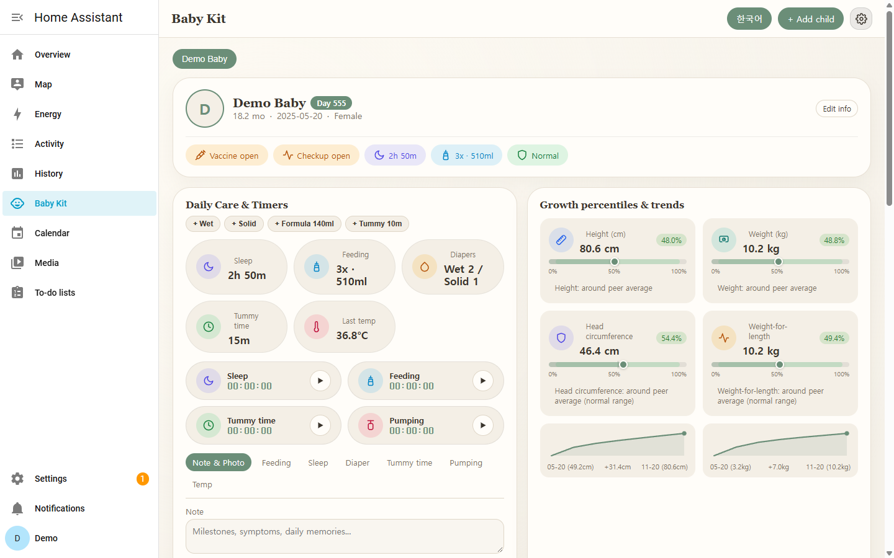
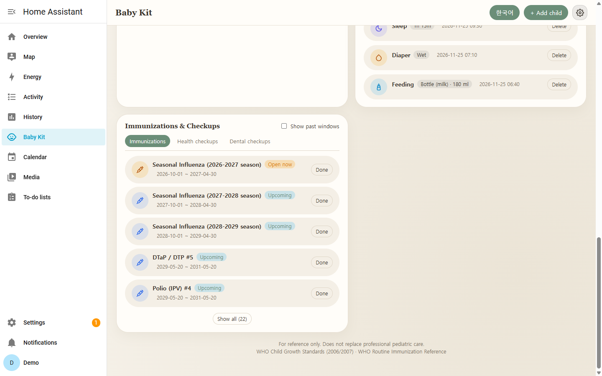

# Baby Kit

[English](README.en.md) | [한국어](README.md)

[](https://github.com/redchupa/kr_baby_kit/actions/workflows/hassfest.yml)
[](https://github.com/redchupa/kr_baby_kit/actions/workflows/test.yml)
[](https://github.com/hacs/integration)
[](https://github.com/redchupa/kr_baby_kit/releases)

An all-in-one baby care companion for Home Assistant — track daily feedings, sleep, diapers, temperatures, photo memories, growth percentiles, and upcoming vaccines or checkups in one place.

Works offline with both International (WHO) and South Korea standards — no cloud accounts or external API keys needed.

## Screenshots

Taken with a made-up demo child.

| Daily care log and growth percentiles | Immunization and checkup schedule |
|:---:|:---:|
|  |  |

## Features

- **LMS growth percentiles**: Enter height, weight, and head circumference to compute percentiles and Z-scores against the child's age at the time of measurement. Height and weight are reported as top-percent rank sensors; bi-directional indicators (head circumference, BMI, weight-for-length) are exposed as `binary_sensor` alerts that turn on only outside the 5th-95th statistical percentile band.
- **Regional profile selection**: Choose between `International (WHO Growth Standards)` and `South Korea (KDCA · NIP · Childcare Tuition)` when registering a child. The default matches your Home Assistant language setting, and you can switch profiles later in the integration options without losing stored measurements.
- **Vaccination, well-child, and dental schedules**: Projected from the child's birthdate into calendars and sensors. Open windows expose a deadline sensor; upcoming windows expose a next-window start sensor.
- **Completion tracking**: Mark completed doses or visits with `kr_baby_kit.mark_event_done` to remove them from upcoming sensors and monthly reminders. Marking is optional; windows that have passed without a mark simply show as passed without triggering warnings.
- **Daily care logs, live timers, 7-day chart & photo diary**: Inspired by Baby Buddy — live stopwatches for sleep, feeding, tummy time, and pumping; quick logs and modal/bottom-sheet logger for diapers, temperature, and notes; 7-day sleep and feeding trend bar chart; child profile avatars and photo-attached timeline entries stored privately under `.storage/kr_baby_kit_media/` and served via short-lived authenticated URLs.
- **Dedicated sidebar panel with 8 layouts, mobile 4-column dense mode & 12 themes**: Adds a `Baby Kit` entry to the Home Assistant sidebar featuring interactive KDCA/WHO LMS growth curve charts, **8 layout modes** (`2-Col Bento`, `3-Col Studio`, `4-Col Dense Matrix`, `Top KPI Cockpit`, `Magazine Split`, `Tabbed App Deck`, `Compact Board`, `Single Feed`), **mobile 2/3/4-column micro-tile density**, 12 themes, and 4 card styles.
- **Built-in Smart Nursery Automation Cookbook**: Browse battle-tested Home Assistant parenting recipes (5-min Follow-Me Baby Cam to kitchen/bathroom when nursery occupancy is 0, 5-min motion-hold virtual sleep sensor, Zigbee formula-station button + "When did the baby last eat?" TTS/Assist) and one-click copy YAML with your `child_id` pre-filled ([Smart Nursery Automation Cookbook](docs/examples/smart-nursery-automations.en.md)).
- **8-language global localization & top-bar language selector**: Supports Korean (`KO`), English (`EN`), Japanese (`JA`), Simplified Chinese (`中文`), Spanish (`ES`), French (`FR`), German (`DE`), and Portuguese (`PT`) across both the sidebar panel and Home Assistant integration translations. Click the top-bar globe button to switch languages instantly or follow `Auto (HA)`, with all dates computed in your Home Assistant local time zone.
- **Assist (LLM API)**: Registers a per-child LLM API for Home Assistant Assist so you can ask about upcoming vaccines, checkups, latest growth percentiles, or today's sleep/feeding/diaper summary in natural language.
- **South Korea childcare tuition (KR profile only)**: Exposes monthly standard tuition, government subsidy, and parent share in KRW based on birth-year age class. Not created when using the International profile.

## Installation

Requires Home Assistant 2024.11 or later and HACS.

### 1. Install from HACS

Baby Kit is in the default HACS list, so there is no need to add a custom repository. Click the button to open Baby Kit in HACS on your own Home Assistant.

[](https://my.home-assistant.io/redirect/hacs_repository/?owner=redchupa&repository=kr_baby_kit&category=integration)

If the button doesn't work, search for **Baby Kit** in **HACS**, download it, and restart Home Assistant.

### 2. Register a child

1. Go to **Settings → Devices & Services → Add integration** and select `kr_baby_kit`.
2. Fill in the child details:

| Field | Example | Notes |
|---|---|---|
| Child name or alias | `Baby A`, `First-born` | Display name on dashboards |
| Birthdate | `2023-05-14` | `YYYY-MM-DD` |
| Sex | Male / Female | Used for sex-specific LMS tables |
| Region / Standard | International (WHO) / South Korea | Selects growth chart and schedule tables |

Add the integration again for additional children. You can edit name, birthdate, sex, or regional standard later under **Settings → Devices & Services → Baby Kit → Configure** while preserving measurement history and completion marks.

## Entities

Each registered child gets one device with the following entities (localized to English when Home Assistant is set to English):

### Measurement inputs (`number`)

- **Record height (today)** (`cm`)
- **Record weight (today)** (`kg`)
- **Record head circumference (today)** (`cm`)

Updating a number entity stores a reading for today (in your Home Assistant local time zone) and refreshes all percentiles immediately. To backfill past measurements, call `kr_baby_kit.record_measurement` with an explicit `date`.

### Growth metrics (`sensor`, `binary_sensor`)

- **Height rank among peers (top %)**, **Weight rank among peers (top %)**: Smaller numbers mean taller/heavier. Raw LMS values (`statistical_percentile`, `z_score`, `summary_en`, `summary_ko`) are available in attributes.
- **Head circumference concern**, **BMI concern**, **Weight-for-length concern**: `binary_sensor` (`problem` device class) that turns on when the statistical percentile falls below 5% or above 95%. Under 24 months, BMI percentile is not defined and the sensor directs you to weight-for-length instead.
- **BMI** (`kg/m²`), **Age (months)** (`mo`)

### Immunization, health checkup, and dental checkup (`sensor`, `binary_sensor`, `calendar`)

Each of the three categories provides:

| Entity | Purpose |
|---|---|
| **Open ... window deadline** | End date of the currently open window (unknown when none is open). `open_events` lists every open item with its deadline and remaining days. |
| **Next ... window start** | Start date of the next future window (`days_until_start` included). |
| **... this month** | Turns on when a non-completed window overlaps the current calendar month. |
| **... schedule** (`calendar`) | Full schedule as all-day events, including past and completed entries. |

### Daily care metrics (`sensor`)

- **Today's sleep** (`min`), **Today's feeding volume** (`mL`), **Today's diapers**, **Last temperature** (`°C`), **Active care timers**
- **Last feeding time**, **Last diaper change**, **Last sleep time** (`timestamp` device class — displays relative time like "1 hour ago" on dashboards and powers TTS / voice queries)
- Care logs and timers recorded in the `Baby Kit` panel or via `kr_baby_kit.log_care` / `start_timer` / `stop_timer` update native Home Assistant sensors immediately.

### Childcare tuition (`sensor`, KRW — South Korea profile only)

- **Monthly standard childcare tuition**, **Monthly government subsidy**, **Monthly parent share**

## Services

| Service | Description |
|---|---|
| `kr_baby_kit.record_measurement` | Record height, weight, and/or head circumference (`date` defaults to today) |
| `kr_baby_kit.delete_measurement` | Delete a full date record or specific fields |
| `kr_baby_kit.get_measurements` | Return stored measurement history (response action) |
| `kr_baby_kit.mark_event_done` | Mark one or more `event_id`s completed (comma-separated) |
| `kr_baby_kit.unmark_event_done` | Remove completion marks |
| `kr_baby_kit.get_schedule` | Return the full schedule with `event_id` and status (`done`, `open`, `upcoming`, `past`) |
| `kr_baby_kit.log_care` | Log feeding, diaper, sleep, tummy time, pumping, temperature, or note from wireless buttons or automations |
| `kr_baby_kit.start_timer` | Start a live sleep, feeding, tummy time, or pumping timer from automations |
| `kr_baby_kit.stop_timer` | Stop an active timer and save elapsed minutes as a care log |

Example `event_id` values: `DTaP_4`, `IIV_2026`, `checkup_3`, `oral_checkup_1`.

## Automation Examples

```yaml
# Notify 14 days before the next vaccine window opens
- alias: Vaccine reminder D-14
  trigger:
    - platform: template
      value_template: >-
        
        {{ t not in ('unknown','unavailable','') and
           (as_datetime(t) - now()).days == 14 }}
  action:
    - service: notify.mobile_app
      data:
        title: "Upcoming immunization"
        message: "{{ state_attr('sensor.kr_baby_kit_<child>_next_vaccine', 'name_en') }} starts in 14 days."

# Notify if BMI percentile falls outside the 5th-95th band
- alias: BMI concern notification
  trigger:
    - platform: state
      entity_id: binary_sensor.kr_baby_kit_<child>_bmi_concern
      to: "on"
  action:
    - service: notify.mobile_app
      data:
        title: "Growth reference alert"
        message: >-
          {{ state_attr('binary_sensor.kr_baby_kit_<child>_bmi_concern', 'summary_en') }}
          Consider reviewing this at your next pediatric visit.
```

```yaml
# Mark all currently open vaccines done in one call
- service: kr_baby_kit.mark_event_done
  data:
    event_id: "{{ state_attr('sensor.kr_baby_kit_<child>_next_vaccine', 'open_event_ids') | join(',') }}"
```

More examples are available in [docs/examples/automation-examples.yaml](docs/examples/automation-examples.yaml).

## Data Sources

### International profile (`global`)

| Dataset | Source |
|---|---|
| Child Growth Standards (0-5y) & Growth Reference (5-19y) | [WHO Child Growth Standards (2006)](https://www.who.int/tools/child-growth-standards) · [WHO Growth Reference 5-19y (2007)](https://www.who.int/tools/growth-reference-data-for-5to19-years) |
| Routine Immunization Reference | [WHO Recommendations for Routine Immunization](https://www.who.int/teams/immunization-vaccines-and-biologicals/policies/who-recommendations-for-routine-immunization---summary-tables) |
| Well-child & Dental Milestones | General pediatric visit milestones (confirm exact national schedules with your local health provider) |

### South Korea profile (`kr`)

| Dataset | Source | License |
|---|---|---|
| Pediatric Growth Charts (LMS) | [KDCA 2017 Growth Charts](https://www.kdca.go.kr/kdca/5458/subview.do) | KOGL Type 1 |
| National Immunization Program (NIP) | [KDCA Immunization Helper](https://nip.kdca.go.kr/irhp/goMainInfo.do) | KOGL Type 1 |
| Infant Health (8) & Oral (4) Checkups | [NHIS](https://www.nhis.or.kr/nhis/healthin/wbhabb02100m01.do) · [MOHW](https://www.mohw.go.kr/board.es?mid=a10503010100&bid=0027&act=view&list_no=362391) | KOGL Type 1 |
| Childcare Tuition Rates (2026) | [Ministry of Education 2026 Guidelines](https://www.daejeon.go.kr/data/drh/sub05/2026_data_02.pdf) | KOGL Type 1 |

See [docs/data-sources.md](docs/data-sources.md) for full references and licensing details.

## Privacy & Storage

- Measurements, care logs, and completion records are stored locally as plain JSON inside Home Assistant's `.storage/` directory. Nothing is sent to external servers.
- Child avatars and diary photos are stored privately under `.storage/kr_baby_kit_media/` (never in unauthenticated `/local/`) and served through `/api/kr_baby_kit/media/...` using short-lived signed Home Assistant auth URLs.
- Removing a child entry (restricted to Home Assistant administrators) deletes its stored measurements, care logs, completion marks, and photo files.
- Measurement inputs are validated against plausible ranges at both the service schema and storage layers.

## Medical Disclaimer

All growth percentiles, immunization schedules, and checkup milestones provided by this integration are for reference only and do not replace professional medical diagnosis or pediatric care.

## License

[MIT License](LICENSE). Public-sector data attributions and notices are listed in [NOTICE](NOTICE).

## Issues & Support

Please open an issue at [GitHub Issues](https://github.com/redchupa/kr_baby_kit/issues) for bug reports or suggestions. Pull requests for translations and documentation are welcome.

If you find this integration useful, you can support maintenance via PayPal:

<table>
  <tr>
    <td align="center">
      <b>PayPal</b><br/>
      
    </td>
  </tr>
</table>
