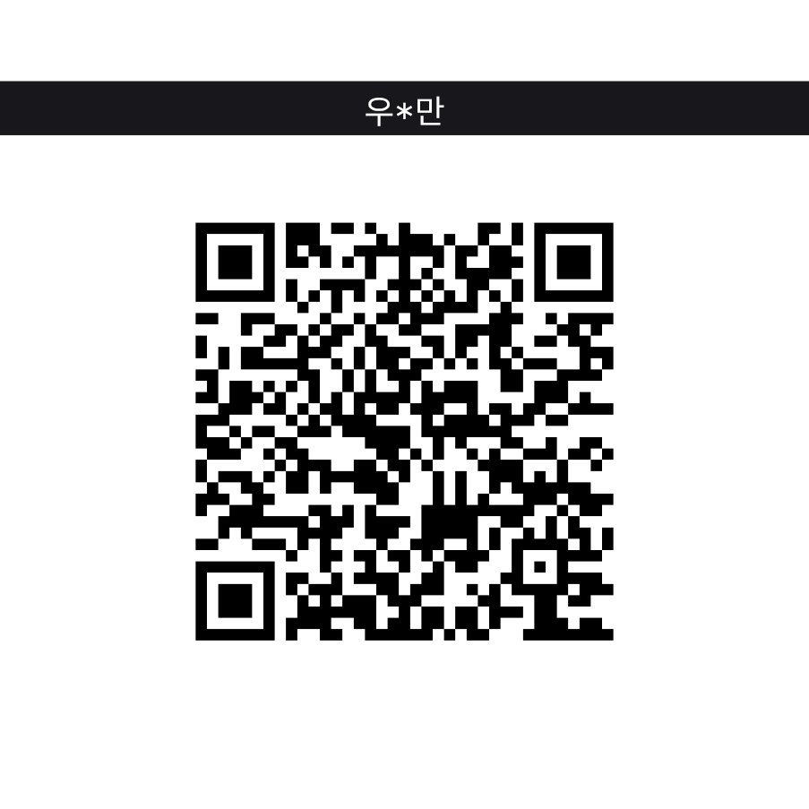

# Korean Baby Kit (한국 영유아 키트)

[한국어](README.md) | [English](README.en.md)

[](https://github.com/redchupa/kr_baby_kit/actions/workflows/hassfest.yml)
[](https://github.com/redchupa/kr_baby_kit/actions/workflows/test.yml)
[](https://github.com/hacs/integration)
[](https://github.com/redchupa/kr_baby_kit/releases)

영유아·어린이의 성장 백분위, 예방접종 일정, 건강검진·구강검진 일정, 보육료 정보를 Home Assistant 센서와 캘린더로 제공하는 HACS 통합입니다.

한국 기준(질병관리청 2017 성장도표, NIP 예방접종, 영유아 검진·구강검진, 교육부 보육료)과 해외 기준(WHO 영유아·청소년 성장 표준, WHO 표준 예방접종 참고 일정)을 모두 지원합니다. 모든 기준표가 통합 안에 포함되어 있어 외부 API 키 없이 오프라인으로 동작합니다.

## 주요 기능

- **성장 백분위 (LMS)**: 키·몸무게·머리둘레를 입력하면 측정일 월령 기준으로 백분위와 Z-score를 계산합니다. 키와 몸무게는 또래 상위 퍼센트로 표시하고, 양쪽 극단이 모두 진료 참고 대상인 머리둘레·BMI·신장별 몸무게는 5% 미만 또는 95% 초과 시에만 켜지는 `binary_sensor`로 분리했습니다.
- **지역 기준 선택**: 자녀를 등록할 때 `대한민국 (KDCA · NIP · 보육료)` 또는 `해외 (WHO Growth Standards)` 중 선택할 수 있으며, 등록 후에도 통합 구성에서 변경할 수 있습니다.
- **예방접종·건강검진·구강검진 일정**: 생년월일 기준으로 전체 일정을 캘린더와 센서로 계산합니다. 지금 기간이 열려 있는 일정의 마감일 센서와 아직 시작하지 않은 다음 일정 시작일 센서를 분리해 두었습니다.
- **완료 표시**: `kr_baby_kit.mark_event_done` 서비스로 완료한 접종이나 검진을 기록하면 다음 일정과 이번 달 알림에서 빠집니다. 따로 체크하지 않아도 기간이 지난 일정은 경고 없이 "기간 지남"으로 처리됩니다.
- **어린이집 보육료 (한국 기준)**: 출생연도 기준 연령반에 맞춰 월 표준보육료, 정부지원금, 본인부담금을 노출합니다. 해외 기준을 선택하면 보육료 센서는 생성되지 않습니다.
- **Assist (LLM API) 연동**: 자녀별 LLM API가 자동 등록되어 "다음 예방접종 언제야?", "키 백분위 알려줘" 같은 자연어 질문에 답할 수 있습니다.
- **돌봄 기록·실시간 타이머·사진 일기**: 수면·수유·터미타임·유축 실시간 타이머와 기저귀·체온·메모 기록을 지원하며, 아이 프로필 사진 및 기록별 사진 첨부(로컬 `/local/kr_baby_kit_media/` 저장, 타임라인·사진 필터·확대 보기)를 사용할 수 있습니다.
- **사이드바 전용 화면 및 테마/구성 커스텀**: Home Assistant 왼쪽 사이드바에 `Baby Kit` 메뉴가 추가되어 아이 정보 조회·수정(이름, 생년월일, 성별, 기준), 아이 추가·삭제(기본 생년월일 `2024-07-01`), 성장 측정 입력, 접종·검진 완료 처리를 한 화면에서 할 수 있습니다. 우측 상단 톱니바퀴 버튼에서 12가지 테마, 1열/2열/컴팩트 레이아웃, 섹션 표시 여부와 순서를 자유롭게 커스텀할 수 있습니다.
- **다국어 및 현지 시간대 지원**: Home Assistant 언어 설정에 따라 한국어 또는 영어로 엔티티 이름, 상태, 요약 문구, 캘린더 일정이 표시되며, Home Assistant에 설정된 현지 시간대를 기준으로 날짜를 계산합니다.

## 설치 방법

Home Assistant 2024.11 이상과 HACS가 필요합니다. (Home Assistant를 처음 사용한다면 [입문 가이드](https://redchupa.com/entry/%ed%99%88%ec%96%b4%ec%8b%9c%ec%8a%a4%ed%84%b4%ed%8a%b8ha-%ec%9e%85%eb%ac%b8-%ea%b0%80%ec%9d%b4%eb%93%9c/)를 참고하세요.)

### 1. HACS에 저장소 추가

1. Home Assistant에서 **HACS** → **Integrations** → 우측 상단 메뉴(⋮) → **사용자 지정 저장소**로 이동합니다.
2. 저장소 URL에 `https://github.com/redchupa/kr_baby_kit` 을 입력하고 카테고리는 **Integration**을 선택해 추가합니다.
3. HACS에서 **Korean Baby Kit**을 검색해 다운로드한 뒤 Home Assistant를 재시작합니다.

### 2. 자녀 등록

1. **설정 → 기기 및 서비스 → 통합 추가**에서 `kr_baby_kit`을 선택합니다.
2. 아래 항목을 입력하고 제출합니다.

| 항목 | 예시 | 설명 |
|---|---|---|
| 자녀 이름 또는 별칭 | `첫째`, `Baby A` | 대시보드 표시명 (실명 대신 별칭 권장) |
| 생년월일 | `2023-05-14` | `YYYY-MM-DD` 형식 |
| 성별 | 남아 / 여아 | 성장도표 성별 기준 |
| 지역 / 기준 | 대한민국 / 해외 (WHO) | 성장도표 및 일정 기준 |

자녀가 여러 명이면 통합 추가를 반복하면 됩니다. 등록 후 이름·생년월일·성별·기준을 바꾸려면 **설정 → 기기 및 서비스 → 한국 영유아 키트 → 구성**에서 수정할 수 있으며, 기존 측정 기록과 완료 표시는 유지됩니다.

## 생성되는 엔티티

자녀 1명당 device 1개가 생성됩니다. 이름 앞부분에 분류가 붙어 있어 이름순으로 정렬하면 항목끼리 묶입니다.

### 측정 입력 (`number`)

- `키_기록하기_오늘_날짜로` (cm)
- `몸무게_기록하기_오늘_날짜로` (kg)
- `머리둘레_기록하기_오늘_날짜로` (cm)

대시보드에서 값을 입력하면 오늘 날짜로 저장되고 백분위가 즉시 갱신됩니다. 과거 날짜의 측정값을 넣으려면 `kr_baby_kit.record_measurement` 서비스를 사용하세요.

### 성장 지표 (`sensor`, `binary_sensor`)

- `키_또래_중_상위_몇_퍼센트`, `몸무게_또래_중_상위_몇_퍼센트`: 숫자가 작을수록 크거나 무거운 편입니다. 속성 `statistical_percentile`에 원래 통계 백분위가 함께 제공됩니다.
- `양극단_주의_머리둘레`, `양극단_주의_BMI`, `양극단_주의_신장별_몸무게`: 통계 백분위가 5% 미만이거나 95% 초과일 때 `주의 필요`로 바뀝니다. 만 24개월 미만은 BMI 백분위 대신 신장별 몸무게를 참고합니다.
- `BMI_체질량지수_수치` (kg/m²), `월령_태어난_지_몇_개월` (mo)

### 예방접종 · 건강검진 · 구강검진 (`sensor`, `binary_sensor`, `calendar`)

세 분류(`예방접종_`, `건강검진_`, `구강검진_`)마다 같은 구조로 생성됩니다.

| 엔티티 | 설명 |
|---|---|
| `..._지금_맞을_수_있는_마감일` / `..._지금_받을_수_있는_마감일` | 현재 기간이 열려 있는 일정의 마감일. 열린 일정이 없으면 비어 있습니다. 속성 `open_events`에 일정별 마감일과 남은 일수가 들어 있습니다. |
| `..._다음_일정_시작일` | 아직 시작하지 않은 다음 일정의 시작일. 속성 `days_until_start` 포함. |
| `..._이번_달_일정` | 이번 달에 걸친 일정이 있으면 켜짐 (`이번 달 접종 있음` 등). |
| `..._전체_일정_캘린더` | 과거와 예정된 전체 일정을 종일 이벤트로 표시. 완료한 일정은 완료 표시가 붙습니다. |

### 보육료 (`sensor`, KRW — 한국 기준 전용)

- `보육료_월_표준_금액`, `보육료_월_정부지원금`, `보육료_월_본인부담금`
- 보육사업안내 기준에 따라 출생연도로 연령반(만 0세반에서 만 6세반)을 판정합니다.

## 서비스 (개발자 도구 → 작업)

| 서비스 | 설명 |
|---|---|
| `kr_baby_kit.record_measurement` | 키·몸무게·머리둘레 기록 (날짜 생략 시 오늘) |
| `kr_baby_kit.delete_measurement` | 특정 날짜의 기록 전체 또는 일부 항목 삭제 |
| `kr_baby_kit.get_measurements` | 저장된 측정 기록 조회 |
| `kr_baby_kit.mark_event_done` | 접종·검진·구강검진 완료 표시 (쉼표로 여러 개 지정 가능) |
| `kr_baby_kit.unmark_event_done` | 완료 표시 취소 |
| `kr_baby_kit.get_schedule` | 전체 일정과 `event_id`, 상태(`done`, `open`, `upcoming`, `past`) 조회 |

`event_id` 예시: `DTaP_4`, `IIV_2026`, `checkup_3`, `oral_checkup_1`

## 자동화 예시

```yaml
# 예방접종 시작 14일 전 모바일 알림
- alias: 예방접종 D-14 알림
  trigger:
    - platform: template
      value_template: >-
        
        {{ t not in ('unknown','unavailable','') and
           (as_datetime(t) - now()).days == 14 }}
  action:
    - service: notify.mobile_app
      data:
        title: "예방접종 일정 알림"
        message: "{{ state_attr('sensor.kr_baby_kit_<자녀>_next_vaccine', 'name_ko') }} 시작까지 14일 남았습니다."

# BMI 양극단 신호 시 모바일 알림
- alias: BMI 양극단 알림
  trigger:
    - platform: state
      entity_id: binary_sensor.kr_baby_kit_<자녀>_bmi_concern
      to: "on"
  action:
    - service: notify.mobile_app
      data:
        title: "성장 참고 알림"
        message: >-
          {{ state_attr('binary_sensor.kr_baby_kit_<자녀>_bmi_concern', 'summary_ko') }}
          다음 진료 시 소아청소년과에서 확인해 보세요.
```

```yaml
# 현재 기간이 열린 접종을 오늘 날짜로 한 번에 완료 처리
- service: kr_baby_kit.mark_event_done
  data:
    event_id: "{{ state_attr('sensor.kr_baby_kit_<자녀>_next_vaccine', 'open_event_ids') | join(',') }}"
```

더 많은 예시는 [docs/examples/automation-examples.yaml](docs/examples/automation-examples.yaml)에 있습니다.

## 데이터 출처

### 한국 기준 (`kr`)

| 데이터 | 출처 | 라이선스 |
|---|---|---|
| 소아청소년 성장도표 (LMS) | [질병관리청 2017 소아청소년 성장도표](https://www.kdca.go.kr/kdca/5458/subview.do) | 공공누리 제1유형 |
| 표준 예방접종 일정 (NIP) | [질병관리청 예방접종도우미](https://nip.kdca.go.kr/irhp/goMainInfo.do) | 공공누리 제1유형 |
| 영유아 건강검진 (8회) · 구강검진 (4회) | [국민건강보험공단](https://www.nhis.or.kr/nhis/healthin/wbhabb02100m01.do) · [보건복지부 보도자료](https://www.mohw.go.kr/board.es?mid=a10503010100&bid=0027&act=view&list_no=362391) | 공공누리 제1유형 |
| 보육료 단가 (2026년) | [교육부 2026년도 보육사업안내 부록 2](https://www.daejeon.go.kr/data/drh/sub05/2026_data_02.pdf) | 공공누리 제1유형 |

### 해외 기준 (`global`)

| 데이터 | 출처 |
|---|---|
| 영유아·청소년 성장 표준 (LMS) | [WHO Child Growth Standards (0-5세, 2006)](https://www.who.int/tools/child-growth-standards) · [WHO Growth Reference (5-19세, 2007)](https://www.who.int/tools/growth-reference-data-for-5to19-years) |
| 예방접종 참고 일정 | [WHO Routine Immunization Recommendations](https://www.who.int/teams/immunization-vaccines-and-biologicals/policies/who-recommendations-for-routine-immunization---summary-tables) |
| 소아·치과 정기검진 참고 일정 | 일반 소아 정기검진 마일스톤 (국가별 일정이 다르므로 현지 소아과 안내를 우선하세요) |

세부 출처와 갱신 이력은 [docs/data-sources.md](docs/data-sources.md)를 참고하세요.

## 개인정보 및 저장 방식

- 측정 기록과 완료 표시는 로컬 Home Assistant의 `.storage/` 디렉터리에 JSON으로 저장되며 외부 서버로 전송되지 않습니다. (별도 암호화는 하지 않으며 Home Assistant의 파일 권한 및 백업 정책을 따릅니다.)
- 등록된 자녀 항목을 삭제하면 해당 자녀의 측정 기록과 완료 표시도 함께 삭제됩니다.
- 잘못된 입력값(음수, 범위 초과, `NaN`, 문자열 등)은 서비스 스키마와 저장 계층에서 검증해 차단합니다.

## 의학적 면책

이 통합이 제공하는 백분위, 예방접종, 검진 정보는 참고용이며 의학적 진단이나 진료를 대체하지 않습니다. 자녀의 성장과 건강 상태는 반드시 소아청소년과 전문의와 상담해 확인하시기 바랍니다.

## 라이선스

[MIT License](LICENSE). 포함된 공공 데이터의 출처 및 고지 사항은 [NOTICE](NOTICE)를 참고하세요.

## 이슈 및 후원

버그 제보나 기능 제안은 [GitHub Issues](https://github.com/redchupa/kr_baby_kit/issues)에 남겨 주세요. 번역 및 문서 기여(PR)도 환영합니다.

프로젝트 유지에 도움이 되셨다면 아래로 후원해 주실 수 있습니다.

<table>
  <tr>
    <td align="center">
      <b>토스</b><br/>
      
    </td>
    <td align="center">
      <b>PayPal</b><br/>
      
    </td>
  </tr>
</table>

- 토스/카카오뱅크: `1000-1261-7813` (우*만)
