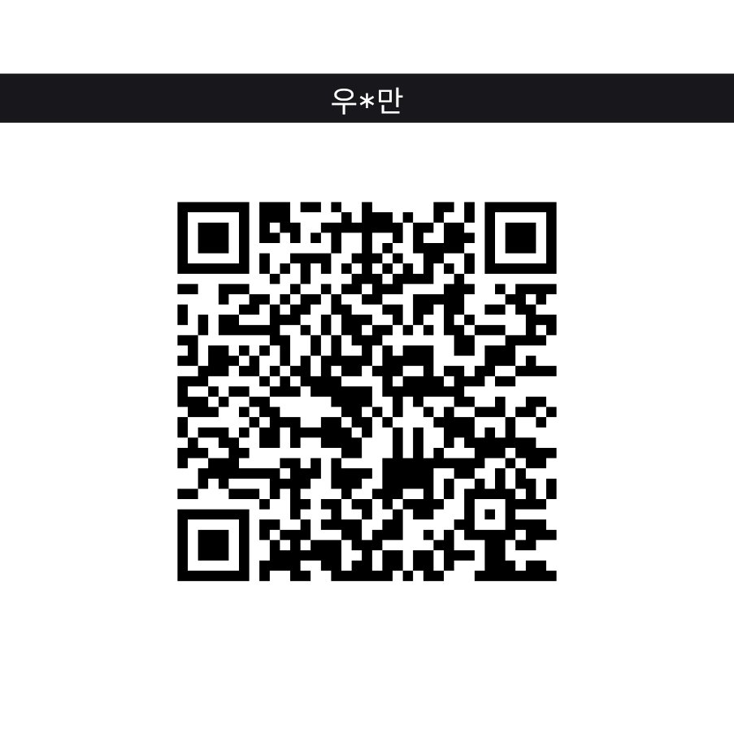
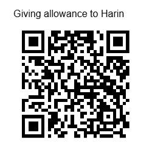

# 한국 영유아 키트 (Korean Baby Kit)

> **아이의 키·몸무게·예방접종·검진·보육료, 매일 잊고 살았던 것들.**
> 측정만 입력하면 나머지는 Home Assistant가 자동으로 챙겨드립니다.

[](https://github.com/redchupa/kr_baby_kit/actions/workflows/hassfest.yml)
[](https://github.com/redchupa/kr_baby_kit/actions/workflows/test.yml)
[](https://github.com/hacs/integration)
[](https://github.com/redchupa/kr_baby_kit/releases)

---

## 👶 이런 부모님께 추천드려요

- 0~7세 자녀를 키우는 분
- Home Assistant를 이미 쓰고 계신 분 (없으면 ▶ [Home Assistant 시작하기](https://redchupa.com/entry/%ed%99%88%ec%96%b4%ec%8b%9c%ec%8a%a4%ed%84%b4%ed%8a%b8ha-%ec%9e%85%eb%ac%b8-%ea%b0%80%ec%9d%b4%eb%93%9c/))
- 아이 성장 기록, 어린이집 알림장, 정부 검진 일정, 보육료 정산… **한 화면에서 보고 싶으신 분**
- 의학 정보는 정확하게, 일상은 단순하게 만들고 싶으신 분

> 💡 **개발자나 IT 전문가가 아니어도 됩니다.** 코드 한 줄 만질 일 없이 마우스 클릭과 슬라이더 조작만으로 사용 가능합니다.

---

## ✨ 이런 순간에 도움돼요

### 🌙 새벽 2시, 아이 키 재고 나서

> "오늘 90.2cm 나왔는데… 또래 평균이야? 작은 거야?"

→ 슬라이더 한 번 움직이면 **"키: 또래 상위 23% (큰 편)"** 즉시 표시.
KDCA 2017 공식 성장표 기준이라 소아과 차트와 같은 결과.

### 📱 출근길, 어린이집 알림장 보다가

> "다음 접종 언제더라? 어린이집 문자에 있던 것 같은데…"

→ 핸드폰 HA 앱 열면 **"디프테리아·파상풍·백일해 4차 — D-14"** 카드가 첫 화면에.
자녀 생일만 입력하면 질병관리청 표준 일정으로 자동 계산. **18종 백신 전부 무료 지원 (NIP)**.

### 🏥 28개월, 영유아 검진 시기 헷갈릴 때

> "30개월 검진은 만 30개월? 우리 애 이제 28개월인데 언제 가야 하지?"

→ **"다음 검진: 2026-08-15 (만 30개월~36개월)"** 명확히 노출.
보건복지부 표준 **8회 검진** (생후 14~35일 신생아 검진부터 만 6세까지) 모두 자동.

### 🦷 18개월, 구강검진도 따로 있다던데?

> "건강검진이랑 구강검진은 시기가 다르다면서… 언제까지 가야 하지?"

→ **`구강검진_지금_받을_수_있는_마감일`** · **`구강검진_다음_일정_시작일`** 센서와 **`구강검진_전체_일정_캘린더`** 가 국민건강보험공단 기준 **구강검진 4회** (18~29 · 30~41 · 42~53 · 54~65개월)를 따로 보여줍니다. 각 일정에 검진 항목(구강문진 및 진찰, 구강보건교육)까지 표시.

### ✅ 접종 맞고 왔어요 — 완료 체크

> "오늘 2개월 접종 다 맞췄는데, 다음 접종 센서에 아직 그대로 떠 있어…"

→ `kr_baby_kit.mark_event_done` 한 번이면 끝. 완료한 접종·검진은 **다음 일정 센서와 "이번 달" 알림에서 빠지고**, 캘린더에는 ✅ 로 남습니다. 귀찮으면 안 해도 됩니다 — 기간이 끝난 일정은 자동으로 "기간 지남"으로 처리되고 경고는 띄우지 않습니다.

### 💰 매월 25일, 어린이집 결제 알림 받기 전

> "다음 달 본인부담금이 얼만지 미리 알 수 있을까?"

→ **"만 2세반 본인부담금: 0원 (무상보육)"** 자녀 만 나이 맞춰 자동.
교육부 **2026년도 실측 단가** (만 0세 584,000원 ~ 만 6세 280,000원) 번들.

### 🚨 BMI 검사 결과가 신경 쓰일 때

> "비만 경향이라고 들었는데… 매번 진료 받으러 가야 하나?"

→ **`BMI 양극단 주의`** binary 알림이 평소엔 OFF.
양극단(< 5% 저체중 또는 > 95% 비만 경향)일 때만 ON으로 바뀌어 빨간 알림. 진단은 의사에게, 신호는 자동으로.

### 🎙️ 손에 아이 안고 있을 때

> 손이 안 비면 음성으로 — *"하이 어시스턴트, 다음 접종 언제야?"*

→ Assist (Home Assistant 음성 비서) 자동 응답. 키 백분위·검진 일정·이번 달 보육료까지 자연어로 질문 가능.

---

## 🚀 30초 설치 (코드 한 줄 안 만져요)

### 1️⃣ HACS에 저장소 추가 (1번만)

Home Assistant 화면에서:

1. **HACS** 메뉴 클릭
2. **Integrations** 탭 → 우상단 **점 3개(⋮)** → **사용자 지정 저장소**
3. 저장소 칸에 붙여넣기:
   ```
   https://github.com/redchupa/kr_baby_kit
   ```
4. 카테고리 → **Integration** 선택 → **추가**

### 2️⃣ kr_baby_kit 다운로드 + 재시작

1. HACS Integrations 검색창에 **"한국 영유아 키트"** 입력
2. 클릭 → **DOWNLOAD** 버튼
3. **Home Assistant 재시작** (설정 → 시스템 → 재시작)

### 3️⃣ 자녀 등록

1. **설정 → 기기 및 서비스 → 통합 추가** 클릭
2. 검색창에 **"kr_baby_kit"** → 선택
3. 자녀 정보 입력:

   | 항목 | 입력 예시 |
   |---|---|
   | 자녀 이름 또는 별칭 | `첫째` · `둘째` · `Baby A` (실명 권장 안 함) |
   | 생년월일 | `2023-05-14` |
   | 성별 | 남아 / 여아 |

4. **제출** 클릭. 끝.

> 🎉 **자녀별로 device 1개와 sensor 14개가 자동으로 생성됩니다.**
>
> 자녀가 둘 이상이라면? 통합 추가를 한 번 더 하시면 됩니다.
>
> 이름·생년월일·성별을 잘못 입력했다면? **설정 → 기기 및 서비스 → 한국 영유아 키트 → 구성** 에서 언제든 수정할 수 있습니다. 측정 기록과 완료 표시는 그대로 유지됩니다.

---

## 📊 등록 후 대시보드에서 보이는 것들

자녀 device 안에 다음 entity들이 자동 생성됩니다. 이름 앞부분이 분류라서 이름순으로 정렬하면 `건강검진_` · `구강검진_` · `예방접종_` · `보육료_` · `양극단_주의_` 끼리 묶입니다.

### 📏 측정 입력 (number)
- `키_기록하기_오늘_날짜로` · `몸무게_기록하기_오늘_날짜로` · `머리둘레_기록하기_오늘_날짜로` — 값을 넣으면 오늘 날짜로 저장 (지난 날짜는 `record_measurement` 서비스)

### 📊 또래 위치 (sensor, %)
- `키_또래_중_상위_몇_퍼센트` · `몸무게_또래_중_상위_몇_퍼센트` — 작은 숫자일수록 크고 무거운 편 (학교 등수처럼)
- 한 줄 요약: *"키: 또래 상위 5.3% (큰 편)"*

### 🚨 양극단 주의 (binary_sensor)
- `양극단_주의_머리둘레` · `양극단_주의_BMI` · `양극단_주의_신장별_몸무게`
- 상태: **주의 필요** (5% 미만 또는 95% 초과) / **주의 신호 없음**

### 💉 예방접종 · 🩺 건강검진 · 🦷 구강검진 (sensor + binary_sensor)
분류마다 같은 3종이 있습니다 (`예방접종_` / `건강검진_` / `구강검진_`):

| entity | 보여 주는 것 |
|---|---|
| `…_지금_맞을_수_있는_마감일` (예방접종) · `…_지금_받을_수_있는_마감일` (검진) | **지금 기간이 열려 있는 일정의 마지막 날**. "51일 후"처럼 표시. 열린 일정이 없으면 비어 있음. `open_events`에 일정별 마감일·남은 일수 |
| `…_다음_일정_시작일` | **아직 시작 안 한 다음 일정의 시작일** (항상 미래 날짜). `days_until_start` 속성 포함 |
| `…_이번_달_일정` | 상태: **이번 달 접종 있음 / 없음** (검진·구강검진도 같은 형식) |

- 완료 표시(`mark_event_done`)한 일정은 세 entity 모두에서 자동으로 빠집니다.

### 🗓️ 캘린더 (calendar)
- `예방접종_전체_일정_캘린더` · `건강검진_전체_일정_캘린더` · `구강검진_전체_일정_캘린더` — 지난 일정까지 전체 표시, 완료 표시한 일정은 ✅
- 상태: **지금 기간 중인 일정 있음 / 없음**

### 🏷️ 보육료 (sensor, KRW)
- `보육료_월_표준_금액` · `보육료_월_정부지원금` · `보육료_월_본인부담금`
- 연령반은 보육사업안내 기준대로 **출생연도**로 정합니다 (예: 2026년에는 2024년생 = 만 1세반, 2023년생 = 만 2세반)

### ℹ️ 부가 정보 (sensor)
- `BMI_체질량지수_수치` (kg/m²) · `월령_태어난_지_몇_개월`

> 💡 v0.9.0에서 이름이 바뀌었지만 **entity_id는 그대로**라 기존 자동화·대시보드는 계속 동작합니다. 새로 생긴 `…_마감일` 3종만 새 entity입니다.

### 🛠️ 서비스 (개발자 도구 → 작업)

| 서비스 | 하는 일 |
|---|---|
| `kr_baby_kit.record_measurement` | 키·몸무게·머리둘레 기록 (날짜 생략 시 오늘) |
| `kr_baby_kit.delete_measurement` | 특정 날짜 기록 전체 또는 일부 항목 삭제 |
| `kr_baby_kit.get_measurements` | 측정 기록 조회 (응답 반환) |
| `kr_baby_kit.mark_event_done` | 접종·검진·구강검진 완료 표시 (쉼표로 여러 개) |
| `kr_baby_kit.unmark_event_done` | 완료 표시 취소 |
| `kr_baby_kit.get_schedule` | 전체 일정 + `event_id` + 상태(done/open/upcoming/past) 조회 |

`event_id` 예시: `DTaP_4` (백신_차수), `IIV_2026` (인플루엔자 2026-2027 절기), `checkup_3` (3차 건강검진), `oral_checkup_1` (1차 구강검진).

---

## 🎨 자동화 예시 (선택, 클릭 한 번이면 됩니다)

```yaml
# 예방접종 D-14에 모바일 알림
- alias: 접종 D-14 알림
  trigger:
    - platform: template
      value_template: >-
        
        {{ t not in ('unknown','unavailable','') and
           (as_datetime(t) - now()).days == 14 }}
  action:
    - service: notify.mobile_app
      data:
        title: "예방접종 임박"
        message: "{{ state_attr('sensor.kr_baby_kit_<자녀>_next_vaccine', 'name_ko') }} 2주 남았어요"

# BMI 양극단 신호 시 모바일 알림
- alias: BMI 양극단 알림
  trigger:
    - platform: state
      entity_id: binary_sensor.kr_baby_kit_<자녀>_bmi_concern
      to: "on"
  action:
    - service: notify.mobile_app
      data:
        title: "성장 알림"
        message: >-
          {{ state_attr('binary_sensor.kr_baby_kit_<자녀>_bmi_concern', 'summary_ko') }}
          소아청소년과 진료를 한 번 받아보세요.
```

```yaml
# 지금 맞을 수 있는 접종을 오늘 날짜로 한 번에 완료 처리 (버튼·스크립트용)
- service: kr_baby_kit.mark_event_done
  data:
    event_id: "{{ state_attr('sensor.kr_baby_kit_<자녀>_next_vaccine', 'open_event_ids') | join(',') }}"
```

더 많은 예시 → [docs/examples/automation-examples.yaml](docs/examples/automation-examples.yaml)

---

## 📚 의학 데이터 — 출처 명확, 무료, 오프라인

| 데이터 | 출처 | 라이선스 |
|---|---|---|
| 소아청소년 성장도표 (LMS) | [질병관리청 2017](https://www.kdca.go.kr/kdca/5458/subview.do) | 공공누리 제1유형 |
| 표준 예방접종 일정 (NIP) | [질병관리청 예방접종도우미](https://nip.kdca.go.kr/irhp/goMainInfo.do) | 공공누리 제1유형 |
| 영유아 건강검진 (8회) · 구강검진 (4회) | [국민건강보험공단](https://www.nhis.or.kr/nhis/healthin/wbhabb02100m01.do) · [국립재활원 정보포털](https://www.nrc.go.kr/portal/html/content.do?depth=ph&menu_cd=03_02_00_04) · [2021 8회 확대 보도자료](https://www.mohw.go.kr/board.es?mid=a10503010100&bid=0027&act=view&list_no=362391) | 공공누리 제1유형 |
| 보육료 단가 (2026년) | [교육부 「2026년도 보육사업안내 부록 2」](https://www.daejeon.go.kr/data/drh/sub05/2026_data_02.pdf) | 공공누리 제1유형 |

> ✅ **모두 정부 공공 데이터**. 외부 API 키 필요 없음. 인터넷이 끊겨도 작동.
> 🤖 보육료 단가가 outdated 되면 GitHub Actions이 매월 1일 자동 점검 후 갱신 issue 생성 (사용자 별도 알림 불필요).

자세히 → [docs/data-sources.md](docs/data-sources.md)

---

## 🔒 자녀 데이터는 안전합니다

- 측정값·완료 표시는 **본인 Home Assistant의 `.storage/` 폴더에만** 일반 JSON으로 저장 (별도 암호화 없음 — HA 백업·접근 권한으로 보호). 외부 서버 전송 0건.
- 자녀 등록을 삭제하면 그 자녀의 측정 기록·완료 표시도 함께 삭제됩니다.
- 외부 API 키 불필요. 인터넷 끊겨도 작동.
- 잘못된 값(`-5`, `99999`, `NaN`, `abc` 등) 입력 시 **3-layer 검증**으로 거부 → 잘못된 데이터로 percentile 계산되는 일 없음.
- 본 레포 코드에 어떤 자녀·가족 식별자도 포함되지 않음 (CI gate로 검증).

## ⚠️ 의학적 면책

본 통합이 제공하는 모든 백분위·접종·검진 정보는 **참고용**입니다.

- 의학적 진단·처방·치료를 대체하지 않습니다.
- 자녀의 성장·건강은 반드시 **소아청소년과 전문의의 진료**를 통해 평가하세요.
- 양극단 알림이 ON이 되었다고 즉시 병원으로 달려가실 필요는 없지만, **다음 검진 때 소아과 의사에게 한 번 더 확인**해보시길 권장합니다.

## 📜 라이선스

[MIT License](LICENSE). 데이터는 공공누리 제1유형으로 재배포되며 출처 표시 의무가 있습니다 (통합이 모든 사용자 노출 지점에 자동 표시). 데이터 출처·면책 고지는 [NOTICE](NOTICE) 참고.

---

## ⭐ 도움이 되셨다면

- **GitHub 저장소 페이지 우상단 ⭐ Star** — 다른 부모님들이 발견하기 쉬워집니다
- **이슈 / 개선 제안** → [Issues](https://github.com/redchupa/kr_baby_kit/issues)
- **번역·문서 기여 환영** → Pull Request

## ☕ 후원

본 통합이 도움이 되셨다면 커피 한 잔으로 응원해주세요! 🙏

<table>
  <tr>
    <td align="center">
      <b>토스</b><br/>
      
    </td>
    <td align="center">
      <b>PayPal</b><br/>
      
    </td>
  </tr>
</table>

- 토스/카카오뱅크: **1000-1261-7813** (우*만) · *커피 한잔은 사랑입니다*

---

<details>
<summary><strong>🌐 English summary</strong></summary>

### Korean Baby Kit for Home Assistant

A HACS integration that turns three measurement inputs (height, weight, head circumference) into a full picture of your child's growth, vaccinations, checkups, and childcare-fee status — using only Korean public-sector data (KDCA, NIP, MOHW, MOE).

**Who is it for?**
Parents of children aged 0–7 who already use Home Assistant and want a single screen for their child's daily measurements, immunization reminders, checkup windows, and monthly childcare-fee figures.

**Key features**
- 📏 LMS-based percentile sensors for height / weight, with school-rank-style readouts ("1%=tallest"); BMI raw value
- 🚨 Bi-directional `*_concern` binary alerts for head circumference, BMI, and weight-for-length (fires when statistical percentile leaves the 5–95 normal band)
- 💉 Auto-computed vaccine calendar from KDCA NIP schedule + D-day `timestamp` sensors
- 🩺 8-stage infant health checkup schedule (보건복지부 — early 14–35 day visit included since 2021)
- 🏷️ Real 2026 childcare-tuition figures from the Ministry of Education, refreshed annually via a `data-stale` GitHub Issue cron
- 🛡️ Three-layer measurement input validation rejects NaN / Inf / non-numeric / out-of-range values with Korean error messages
- 🎙️ Per-child LLM API (Assist) for natural-language queries
- 🌐 Fully offline — no API keys, all reference tables bundled
- ✅ `hassfest`, HACS validation, pytest matrix (3.11 / 3.12 / 3.13), privacy-grep CI gates

**Setup time:** under a minute through HACS Custom Repositories.

**Data licence:** KOGL Type 1 (attribution required, redistribution OK). The integration surfaces the citation automatically.

**Medical disclaimer:** Reference only. Does not replace pediatrician care. The `*_concern` binary sensors are signals, not diagnoses.

</details>
